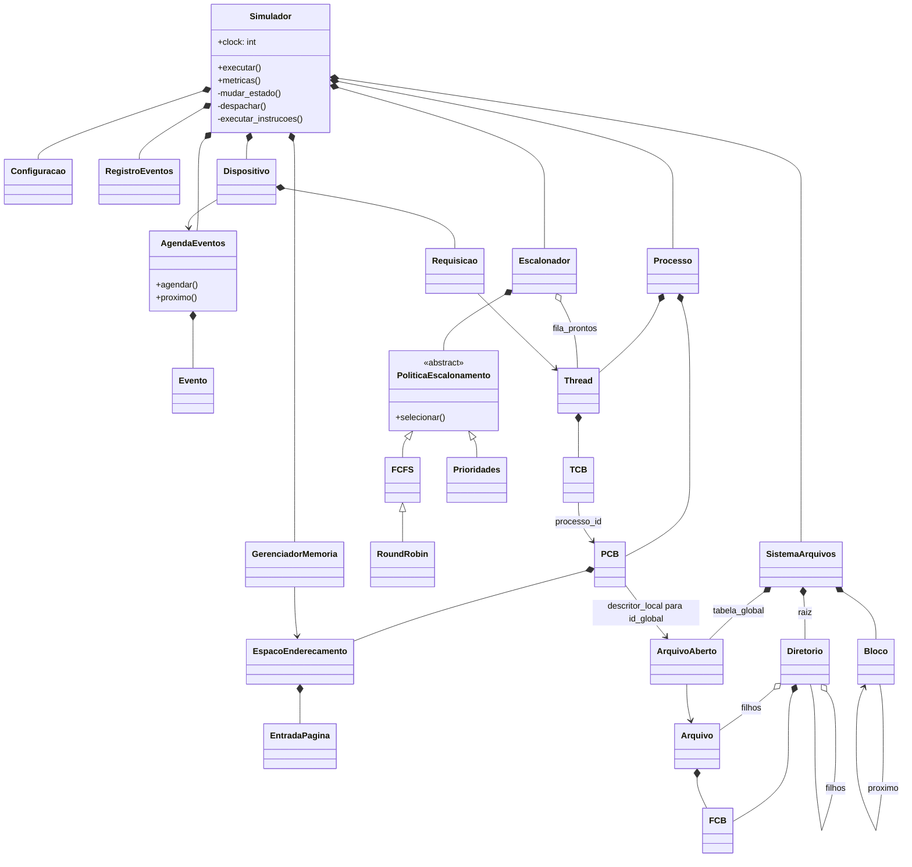
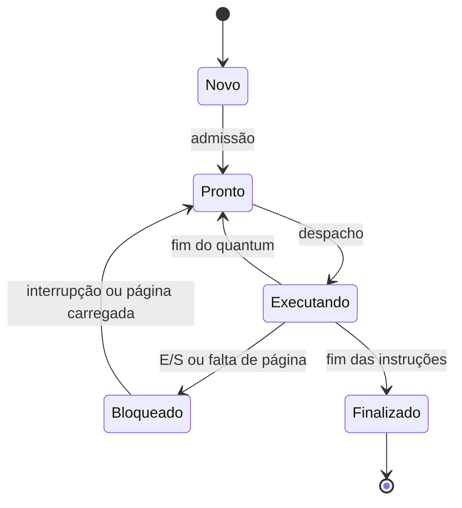

# Arquitetura e classes

O núcleo compõe os mecanismos e fornece o tempo comum. O gerenciador de memória decide presença/tradução/vítima; o núcleo agenda a latência e muda estados. Dispositivos agendam as próprias conclusões e notificam o núcleo por callback. O sistema de arquivos recebe explicitamente o clock em cada chamada e não depende da interface.

O escalonador mantém uma única fila; a política seleciona um índice. Round Robin herda a seleção FCFS porque usa a mesma ordem, enquanto o núcleo aplica seu limite temporal. Prioridades substitui apenas o critério de seleção. A herança fica limitada às políticas; as entidades do SO usam composição.

TCB guarda contexto privado; PCB guarda recursos compartilhados. O processo deriva seu estado dos TCBs: quando uma thread bloqueia, ele pode continuar pronto se outra thread estiver na fila. A máquina de transições explicitamente validada é a da unidade escalonável, a thread.

Não há relógio real ou concorrência hospedeira. Cada intervalo de CPU agenda sua conclusão; chegadas e interrupções no meio desse intervalo são processadas sem alterar a propriedade da CPU. O simulador só despacha uma nova thread quando a anterior libera a CPU.
